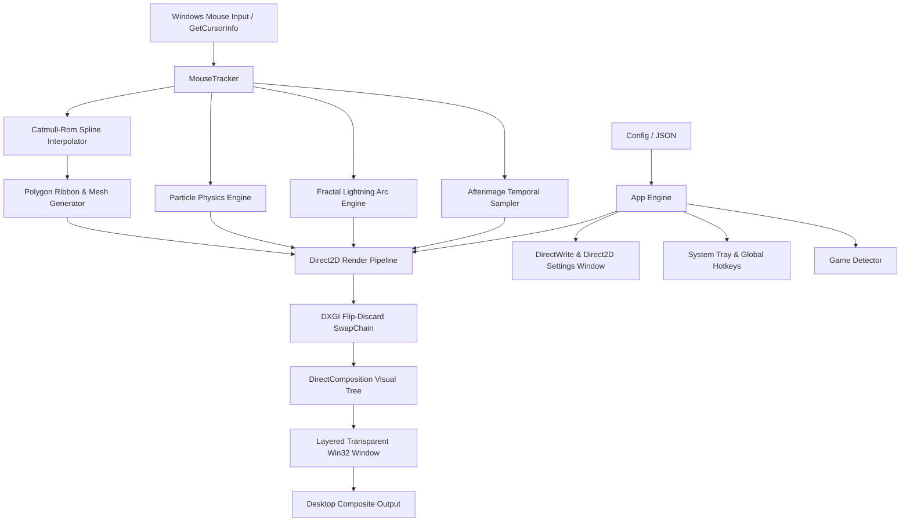

# MouseBlur 🚀

<p align="center">
  
</p>

> **High-Performance, Hardware-Accelerated Mouse Cursor Motion Blur & Visual Mods for Windows**  
> Built in 100% pure Rust with DirectComposition, Direct3D 11, Direct2D, and DirectWrite.


---

## 📚 Complete Documentation

Detailed technical guides and documentation are available in the [`docs/`](docs/) directory:

* 🏗️ **[Architecture Guide](docs/architecture.md)** — GPU pipeline, DirectComposition flip model, 1000Hz sampling thread, and Catmull-Rom math.
* 🚀 **[Setup & Installation](docs/setup.md)** — Prerequisites, MSVC resource compilation, build instructions, and autostart setup.
* 🎨 **[Visual Mods Catalog](docs/visual-mods.md)** — Deep dive into all 8 visual mods, rendering algorithms, and color presets.
* ⚙️ **[Configuration Reference](docs/configuration.md)** — Full `config.json` schema, CLI arguments, and global hotkeys.
* 🤝 **[Contributing Guide](docs/contributing.md)** — Architecture tour, test verification, and tutorial for adding new visual mods.

---

## ⚡ Overview

**MouseBlur** injects fluid, buttery-smooth cinematic motion blur and cursor visual effects behind the Windows hardware mouse pointer. Unlike heavy screen capture overlays or slow GDI utilities, MouseBlur uses native Microsoft DirectX APIs:

1. **DirectComposition & DXGI Flip-Model**: Renders onto a desktop-wide click-through overlay window (`WS_EX_NOREDIRECTIONBITMAP | WS_EX_LAYERED | WS_EX_TRANSPARENT | WS_EX_TOPMOST | WS_EX_TOOLWINDOW | WS_EX_NOACTIVATE`) with per-pixel alpha transparency and **zero latency kernel-level click bypass**.
2. **Direct2D Hardware Vector Pipeline**: Generates sub-pixel anti-aliased Catmull-Rom spline ribbons, particle systems, electric plasma arcs, and shutter-exposure motion blur directly on the GPU.
3. **Dedicated Software Settings Menu GUI**: Built-in hardware-accelerated dark mode configuration window rendered via Direct2D & DirectWrite with custom app icon.
4. **0.0% Idle CPU Overhead**: When the cursor is stationary, the render loop automatically sleeps via high-precision Windows wait timers (`timeBeginPeriod(1)`). Zero cycles wasted when not moving!
5. **Windows Startup Integration**: Seamlessly start on system boot via Windows Registry (`HKCU\...\Run`), configurable via Settings, Tray, or CLI.
6. **Smart Fullscreen Game Detection**: Automatically pauses rendering when borderless or exclusive fullscreen games are in focus.
7. **Global Hotkeys**: Instant blur toggle via <kbd>Ctrl</kbd> + <kbd>Alt</kbd> + <kbd>M</kbd>, instant Settings Window toggle via <kbd>Ctrl</kbd> + <kbd>Alt</kbd> + <kbd>S</kbd>, or right-click tray context menu.

---

## 🎛️ Software Settings Menu GUI

MouseBlur includes a dedicated, GPU-rendered dark-mode Settings & Mods GUI window (`mouseblur --settings` or via System Tray):

* **Visual Mods Tab**: Interactive card catalog of all 8 visual mods with instant real-time live preview.
* **Motion & Trail Tab**: Real-time interactive sliders for Tail Duration (ms), Head Width, Tail Width, Trigger Velocity, Max Smear Velocity, and Opacity.
* **Colors & Themes Tab**: Clickable palette swatches (Neon Cyan, Pure White, Electric Purple, Sunset Orange, Matrix Green, Rainbow Wave) and mod-specific sliders (Glow Radius, RGB Split Distance, Speed Lines Density, Plasma Jitter, Particle Count).
* **System & Screen Tab**: Toggles for Start with Windows, Fullscreen Game Detection, Notification Area Tray Icon, Target FPS limiter (0 = VSync, 60, 120, 144, 240, 360), and Hotkey information.

---

## 🎨 Visual Mods Catalog

MouseBlur offers **8 distinct visual mods**:

1. **Smear Ribbon (Motion Blur)**: Dynamically computes Catmull-Rom spline curves between cursor coordinates and renders a tapered 2D polygon ribbon whose width and opacity scale with cursor velocity.
2. **Ghost Afterimages**: Spawns fading temporal copies of the cursor pointer along historical trajectory points.
3. **Hybrid Smear + Ghost**: Combines the high-speed smear ribbon with afterimage pointer ghosting for maximum motion clarity.
4. **Neon Bloom**: Double-layer energetic laser ribbon with wide diffuse ambient neon glow.
5. **Particle Sparks**: High-velocity mouse movement emits luminous trailing particles/sparkles that drift with physics (velocity damping, particle lifetime, jitter).
6. **Chromatic Aberration (RGB Split)**: Velocity-directed color dispersion splitting Red, Green, and Blue channels along the direction of motion, mimicking cinematic optical motion blur!
7. **Action Speed Lines**: Parallel action speed-lines trailing behind the cursor when making fast flicks.
8. **Plasma Lightning Arc**: Fractal electric plasma arcs snapping between recent waypoints with energetic crackle.

---

## 🌈 Color Themes

Choose from built-in presets or configure your own RGBA values:
* **Cyber Neon Cyan** (Default `#00F0FF`)
* **Pure White**
* **Electric Purple**
* **Sunset Orange**
* **Matrix Green**
* **Rainbow Wave** (Smooth dynamic hue-cycling spectrum)
* **Custom RGBA**
* **Rainbow Wave** (Smooth dynamic hue-cycling spectrum)
* **Custom RGBA**

---

## 🛠️ Installation & Setup

### Option 1: 1-Click Windows Installer (Recommended)
Download and run **[`MouseBlur-Setup.exe`](https://github.com/Arsh-Pathan/MouseBlur/releases)**:
* Installs cleanly to `%LOCALAPPDATA%\Programs\MouseBlur` (no admin privileges needed).
* Creates **Desktop** and **Start Menu** shortcuts with custom application icons.
* Registers in Windows **Settings > Apps > Installed Apps** for 1-click uninstalling.
* Launches MouseBlur into your system tray and opens the Settings menu.

### Option 2: Portable Binary
1. Download `MouseBlur-v1.0.0-windows-x64.zip` from [Releases](https://github.com/Arsh-Pathan/MouseBlur/releases).
2. Extract anywhere and double-click `mouseblur.exe` or `run.bat`.

### Option 3: Build from Source
```powershell
git clone https://github.com/Arsh-Pathan/MouseBlur.git
cd MouseBlur
cargo build --release
```
The optimized executable will be located at `target\release\mouseblur.exe`.

---

## 🚀 Usage

### Quick Launch (Double Click or Terminal)
Double-click [`run.bat`](file:///C:/Users/ArshPathan/OneDrive/Attachments/Desktop/MouseBlur/run.bat) or run:
```powershell
.\target\release\mouseblur.exe
```
*(By default, this launches MouseBlur and opens the visual Settings & Mods window immediately).*

### Start Minimized to Tray
```powershell
.\target\release\mouseblur.exe --minimized
```

### Restart / Terminate Old Instances
```powershell
.\target\release\mouseblur.exe --restart
```

### Hotkeys
* <kbd>Ctrl</kbd> + <kbd>Alt</kbd> + <kbd>S</kbd>: Open/Focus the Settings & Mods window anywhere in Windows.
* <kbd>Ctrl</kbd> + <kbd>Alt</kbd> + <kbd>M</kbd>: Instantly toggle motion blur ON / OFF.

---

## ⚙️ Configuration File

Configuration is saved in `%APPDATA%\MouseBlur\config.json`:
```json
{
  "enabled": true,
  "mode": "Smear",
  "color_preset": "NeonCyan",
  "custom_color_rgba": [0.0, 0.94, 1.0, 0.85],
  "tail_duration_ms": 130.0,
  "max_trail_points": 40,
  "min_velocity": 80.0,
  "max_velocity": 2800.0,
  "head_width": 14.0,
  "tail_width": 1.0,
  "opacity": 0.85,
  "target_fps": 0,
  "pause_in_fullscreen": true,
  "show_tray_icon": true,
  "afterimage_count": 6,
  "afterimage_spacing_ms": 16.0,
  "particle_count": 24,
  "glow_radius": 8.0,
  "rgb_split_distance": 6.0,
  "speed_lines_count": 5,
  "plasma_jitter": 12.0
}
```

---

## 🧩 Architecture



---

## 📜 License

Licensed under either of:
* Apache License, Version 2.0 ([LICENSE-APACHE](LICENSE-APACHE))
* MIT license ([LICENSE-MIT](LICENSE-MIT))
