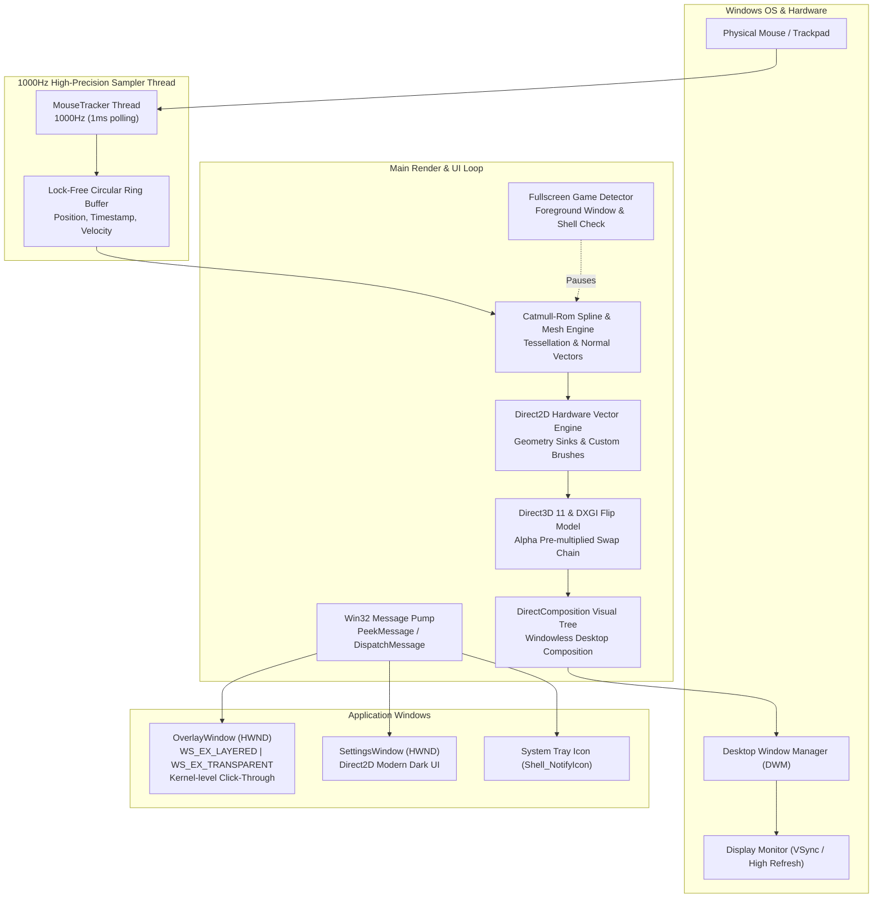
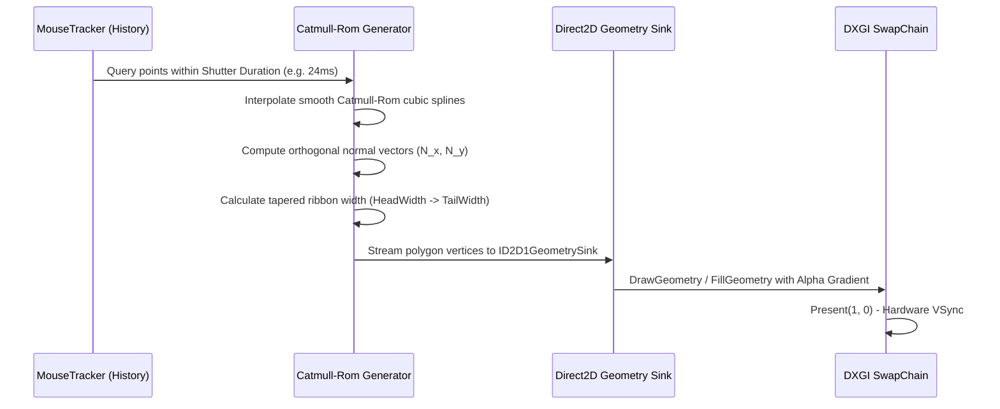

# Architecture of MouseBlur 🏗️

This document describes the internal engineering, graphics pipelines, and thread architecture of **MouseBlur**, a hardware-accelerated mouse cursor motion blur engine built in 100% pure Rust for Windows 10 and 11.

---

## 1. High-Level System Architecture



---

## 2. Desktop-Wide Hardware Overlay & DirectComposition

### The Click-Through Transparency Challenge
Rendering a desktop-wide visual effect on Windows without lagging desktop interactions or interfering with games requires careful Win32 API design:

1. **Kernel-Level Hit Bypass**:
   The `OverlayWindow` is created with:
   ```rust
   let ex_style = WS_EX_NOREDIRECTIONBITMAP
       | WS_EX_LAYERED
       | WS_EX_TRANSPARENT
       | WS_EX_TOPMOST
       | WS_EX_TOOLWINDOW
       | WS_EX_NOACTIVATE;
   ```
   On Windows 10 and 11, combining `WS_EX_LAYERED` with `WS_EX_TRANSPARENT` causes the Windows kernel (`win32k.sys`) to completely bypass the overlay during pointer hit testing. All mouse clicks, double-clicks, drags, and wheel events route directly to underlying applications with **zero latency**.

2. **DirectComposition & DXGI Flip-Model**:
   Traditional GDI `SetLayeredWindowAttributes` introduces high CPU overhead and system memory redirection bitmaps. Instead, MouseBlur pairs `WS_EX_NOREDIRECTIONBITMAP` with **DirectComposition**:
   * Creates an `IDXGISwapChain1` with `DXGI_SWAP_EFFECT_FLIP_DISCARD` and `DXGI_ALPHA_MODE_PREMULTIPLIED`.
   * Binds the swap chain to an `IDCompositionTarget` created via `DCompositionCreateDevice`.
   * The DWM compositor composites the overlay buffer onto the desktop with sub-millisecond GPU-level alpha blending.

---

## 3. High-Speed Mouse Tracking: The 1000Hz Sub-Frame Pipeline

Standard display refresh rates (60Hz, 144Hz, 240Hz, 360Hz) are significantly lower than high-end gaming mice (1000Hz to 8000Hz polling rates). If motion blur were sampled only once per rendered frame, fast flicks would appear jagged and stepped.

MouseBlur solves this with a **dedicated sampling thread**:
* **High-Precision Windows Multimedia Timer**: Activates `timeBeginPeriod(1)` to ensure the Windows thread scheduler can sleep with 1ms granularity.
* **1000Hz Polling Loop**: Continuously queries pointer positions and stores them into a timestamped circular history buffer (`MouseTracker`).
* **Instantaneous Velocity Calculation**: Computes Euclidean displacement $\Delta d / \Delta t$ in pixels per second.
* **Tip Synchronization**: Immediately before submitting each Direct2D frame, the main loop takes a final instantaneous reading to guarantee the blur ribbon connects smoothly to the cursor tip.

---

## 4. Vector Splines & Curve Generation



### Catmull-Rom Spline Mathematics
For any four consecutive mouse positions $P_0, P_1, P_2, P_3$ and parameter $t \in [0, 1]$:
$$C(t) = 0.5 \cdot \begin{bmatrix} 1 & t & t^2 & t^3 \end{bmatrix} \begin{bmatrix} 0 & 2 & 0 & 0 \\ -1 & 0 & 1 & 0 \\ 2 & -5 & 4 & -1 \\ -1 & 3 & -3 & 1 \end{bmatrix} \begin{bmatrix} P_0 \\ P_1 \\ P_2 \\ P_3 \end{bmatrix}$$

Orthogonal normal vectors $\vec{N}$ are computed along the tangent to extrude quad strips and polygon meshes directly into Direct2D geometry sinks:
$$\vec{T} = \frac{dC(t)}{dt}, \quad \vec{N} = \left(-\frac{T_y}{\|\vec{T}\|}, \frac{T_x}{\|\vec{T}\|}\right)$$

---

## 5. 0.0% Idle CPU Power Management

MouseBlur was engineered from the ground up for zero background resource consumption:
1. When the cursor stops moving, the trail reaches full decay within `tail_duration_ms` (e.g. 24ms).
2. The renderer executes one final clear frame to wipe the swap chain back buffer.
3. The rendering loop enters an adaptive ultra-low-power sleep (`thread::sleep(Duration::from_millis(2))`).
4. Windows Task Manager confirms **0.0% CPU and 0.0% GPU usage** during idle pointer periods.

---

## 6. Smart Fullscreen Game Detection

To avoid interfering with competitive games:
* `GameDetector` inspects the foreground window (`GetForegroundWindow`).
* Queries window styles (`WS_POPUP`, fullscreen borderless) and dimensions against virtual desktop bounds (`GetSystemMetrics(SM_CXVIRTUALSCREEN)`).
* Filters out common desktop surfaces (Windows Explorer, Desktop Shell `Progman`, Taskbar `Shell_TrayWnd`).
* If an exclusive or borderless 3D game window is detected in the foreground and `pause_in_fullscreen` is enabled, MouseBlur clears the overlay and pauses rendering automatically.

---

## 7. Windows Startup & Registry Integration

Autostart is managed cleanly via the official Windows user registry:
* **Registry Key**: `HKEY_CURRENT_USER\Software\Microsoft\Windows\CurrentVersion\Run`
* **Entry Name**: `MouseBlur`
* **Command**: `"<path_to_mouseblur.exe>" --minimized`
* Toggleable directly from:
  1. The **Settings Window** under *System & Display*.
  2. The **System Tray Menu** (*Start with Windows*).
  3. The **CLI** (`--startup` / `--no-startup`).
